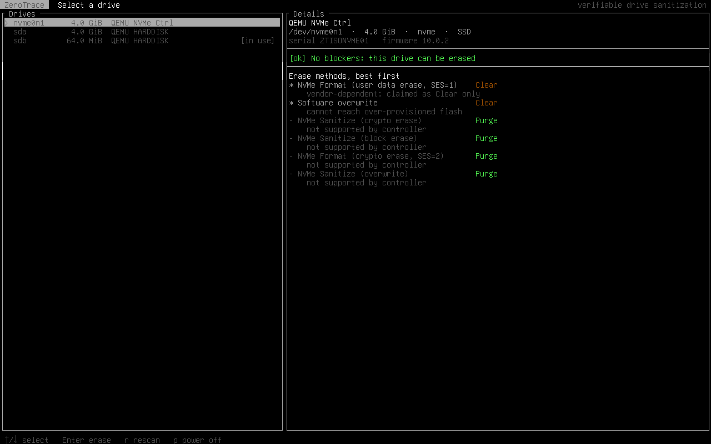
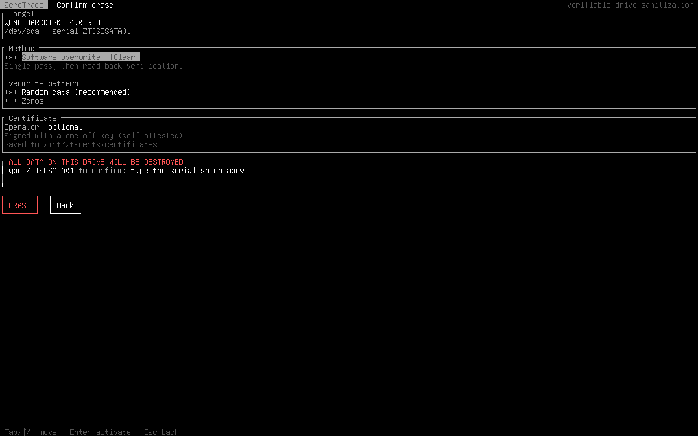

# PurgeMark

Website: [purgemark.skysec.org](https://purgemark.skysec.org)

PurgeMark wipes drives and then proves it. You boot a small Linux ISO, pick a disk, and it erases the disk using the drive's own sanitize commands where it can (falling back to an overwrite where it can't), reads the disk back to check the old data is really gone, and writes out a certificate signed with Ed25519 that anyone can verify later.

I started this for Smart India Hackathon 2025 (problem SIH25070, secure data wiping for IT asset recycling). That version didn't work, so this is a rewrite from scratch. [docs/history.md](docs/history.md) has the story.



## Download

**[Get the ISO from the releases page](https://github.com/spryzz3n/PurgeMark/releases/latest)**. Each release lists its SHA-256 checksum.


Write it to a USB stick with Rufus, balenaEtcher or `dd`, and boot from it. Read the status section below before using it on anything real.

## Status

Early, and not something to point at a disk you care about yet. What exists and has been tested in VMs:

- the live ISO, booting on UEFI and legacy BIOS
- software overwrite and NVMe Format, each followed by a read-back check
- signed certificates, a command-line verifier and a browser verifier
- refusing to touch disks that are mounted, used as swap, or part of LVM/RAID/LUKS
- refusing NVMe erases that reach the whole controller while another namespace on it is in use

Written but not yet run on real hardware: NVMe Sanitize and ATA SANITIZE. QEMU doesn't emulate either, so they're marked experimental. The UI lists them when a drive supports them but never picks them by default. ATA Security Erase isn't implemented, on purpose: if it fails halfway the drive can stay password-locked.

An Android app for phones is in progress.

## How it works

1. **Find the disks.** Read sysfs, skip virtual devices, and work out which disks are in use. A mounted disk (including the USB stick the ISO booted from), active swap, or an LVM/RAID/dm holder all block the erase. The erase itself also opens the device with `O_EXCL`, which the kernel refuses if anything still holds it.
2. **Ask the drive what it supports.** NVMe Identify through the admin ioctl, ATA IDENTIFY through SCSI/ATA translation (`SG_IO`). From that, rank the methods and label each with its NIST SP 800-88 level. Where the level depends on how the vendor implemented the command, I list it as Clear rather than Purge.
3. **Erase.**
   - Overwrite writes the whole disk once with an AES-256-CTR keystream, or zeros if you ask for them.
   - Firmware methods hand the job to the drive.
4. **Check.**
   - After an overwrite, about 1000 random 64 KiB regions are read back with `O_DIRECT` (so the page cache can't fake a pass) and compared with the keystream. The keystream can be regenerated at any offset, which is why random data can still be checked.
   - For firmware methods the expected contents aren't known in advance, so random "canaries" are written into the sampled regions first and every one of them has to be gone afterwards. That also catches a drive that reports success without erasing anything.
5. **Sign.** The result goes into a JSON certificate. The signature covers the RFC 8785 canonical form, so reformatting the file doesn't break it. [docs/certificates.md](docs/certificates.md) explains the format and what a valid signature does and doesn't prove.

More detail is in [docs/design.md](docs/design.md).

## Using it

On the live ISO everything happens in a full-screen app that works with a mouse or the keyboard. If graphics can't start on a machine, it falls back to the terminal UI. To keep certificates after power-off, plug in a second USB stick labelled `PM-CERTS` (FAT32 or exFAT). If it holds an `operator.key`, that key is used to sign. Without the stick the certificates stay in RAM and the UI warns you about it. Press `p` twice to power off. Ctrl+Alt+F2 gives you a root shell.



The same pieces work from the command line on any Linux box:

```sh
pmark list                                    # disks, and why each one is blocked
sudo pmark probe                              # what each drive supports
pmark keygen ~/operator                       # operator.key (keep it safe) + operator.pub
sudo pmark erase sdb --key ~/operator.key --operator "Your Name" --out certs/
pmark verify-cert certs/purgemark-*.json --trusted-key ~/operator.pub
sudo purgemark-gui                         # the graphical UI (needs GTK4)
sudo purgemark                             # the terminal UI
```

`pmark erase` picks the best tested method by default. `--method` chooses one explicitly, and the untested ones also need `--experimental`. To try it without a spare disk, `pmark erase --image disk.img` works on an image file or a loop device.

### Verifying a certificate

The easiest way is **[purgemark.skysec.org/verify](https://purgemark.skysec.org/verify/)**. Drop the certificate file on the page and it tells you whether the signature is valid, what drive it covers, how it was erased, and whether the check passed. If the person who erased the drive gave you their public key, paste it in to confirm the certificate came from them. The check runs entirely in your browser, so the file is never uploaded anywhere.

The same page is in this repo as [verifier/index.html](verifier/index.html) if you'd rather run it offline. It works opened straight from disk. From the command line, `pmark verify-cert` does the same thing.

## Building

Linux only. You need a C++20 compiler, CMake 3.25+, OpenSSL 3 and nlohmann-json. FTXUI is used from the system if it's installed, otherwise CMake downloads v5.0.0.

```sh
cmake -S . -B build -G Ninja
cmake --build build
ctest --test-dir build
node verifier/test.js
```

The ISO needs a Debian 13 machine with live-build:

```sh
sudo apt install live-build cmake ninja-build g++ git libssl-dev nlohmann-json3-dev
sudo iso/build.sh
```

That builds the binaries, drops them into the image and produces `iso/live-image-amd64.hybrid.iso`. [docs/testing.md](docs/testing.md) describes how I tested it on Proxmox, including the destructive integration test in `tests/integration/`.

## Layout

```
core/      the library: discovery, safety checks, NVMe/ATA commands, erase,
           verification, canonical JSON, certificates
cli/       the pmark command
gui/       the purgemark-gui GTK4 app the ISO boots into
tui/       the purgemark terminal UI
verifier/  browser verifier and its cross-implementation test
iso/       live-build config, kiosk service, boot settings
tests/     unit tests, plus the destructive integration test
docs/      design notes, certificate format, testing, history
```

## License

GPL-3.0. Copyright (C) 2026 spryzz3n.
